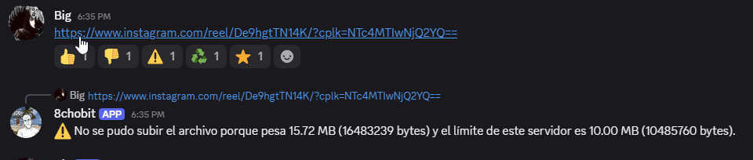

# Bot de memes para Discord
Bot basado en discord.js v14 para administrar un canal de memes, reenviar contenido de redes sociales y publicar mensajes destacados en un servidor.

  

## Requisitos

  

- Node.js 22 o superior.

- Una aplicación y un bot creados en el [Portal de Desarrolladores de Discord](https://discord.com/developers/applications).

- Permisos para invitar el bot al servidor y configurar sus intents.

  

## Instalación

  

1. Clona o descarga este repositorio.

2. Instala las dependencias:

  

```sh

npm install

```

  

3. Crea un archivo `.env` en la raíz y agrega el token del bot:

  

```env

DISCORD_TOKEN=tu_token

```

  

También se puede configurar el token en `settings.json`, pero se recomienda usar `.env` y no compartir ese archivo.

  

4. Revisa `settings.json` para configurar el prefijo, los comandos por mensaje y la presencia.

5. Inicia el bot:

  

```sh

npm start

```

  

## Configuración en Discord

  

Activa los siguientes intents en el Portal de Desarrolladores:

  

- Server Members Intent no es necesario para la configuración predeterminada.

- Message Content Intent para usar comandos con prefijo y procesar mensajes de memes.

  

El cliente solicita los intents de servidores, mensajes de servidor, reacciones y contenido de mensajes. Los permisos recomendados para el bot son:

  

- Ver canales y leer el historial de mensajes.

- Enviar mensajes y adjuntar archivos.

- Agregar reacciones y administrar mensajes.

- Administrar webhooks para reenviar contenido con el nombre y avatar de su autor.

  

El bot necesita acceso al canal de memes y al canal donde se publicarán los destacados. Los permisos efectivos pueden configurarse por canal.

  

## Comandos

  

-  `/memes` o `!memes`: abre el panel de configuración. Solo lo pueden usar el propietario del servidor o miembros con los permisos Administrador o Administrar servidor.

-  `/prefix` o `!prefix`: muestra o cambia el prefijo del servidor. Requiere los mismos permisos que el panel.

-  `/ping` o `!ping`: muestra la latencia del bot.

  

Los comandos con prefijo se pueden activar o desactivar en `settings.json`, en `messageContentCommands.status`. El prefijo predeterminado es `!`.

  

## Panel de memes

  

El panel de `/memes` incluye estas categorías:

  

-  **Resumen**: muestra el estado de las funciones y permite activar o pausar algunas opciones.

-  **Memes**: selecciona el canal de memes. La selección se guarda automáticamente. El bot puede agregar reacciones a los mensajes nuevos de ese canal:

- Like.

- No me gusta.

- Advertencia por gemidos o audio sugerente.

- Meme repetido.

-  **Enlaces sociales**: activa o pausa la descarga y el reenvío de medios compatibles.

-  **Destacados**: configura el canal de publicación, el emoji de voto y el mínimo de votos. También permite enviar una publicación de prueba.

  

Los destacados cuentan las reacciones de usuarios humanos en el canal de memes configurado. Cuando un mensaje alcanza el mínimo establecido, el bot lo publica en el canal de destacados y actualiza la publicación conforme cambia el conteo.

  

## Reenvío de enlaces sociales

  

El reenvío solo se realiza cuando está activado y el mensaje se publica en el canal de memes configurado. El bot intenta descargar medios de enlaces públicos compatibles y los publica mediante un webhook con el nombre y avatar de quien envió el mensaje. Después intenta eliminar el mensaje original, por lo que necesita el permiso Administrar mensajes en ese canal. Si Discord rechaza el borrado, el mensaje original se conserva y el bot avisa que falta ese permiso.

  

Antes de descargar y reenviar, elimina parámetros de seguimiento conocidos de los enlaces, incluidos parámetros comunes `utm_*` y algunos específicos de cada plataforma. En el webhook los enlaces aparecen como enlaces Markdown con una etiqueta, y se suprime la vista previa automática para evitar duplicar el medio adjunto. No se publica un aviso separado sobre la limpieza de enlaces.

  

La descarga puede fallar si una publicación es privada, requiere iniciar sesión, tiene restricciones regionales o la plataforma cambia. El tamaño máximo de los archivos depende del nivel de boost del servidor. Si el bot no puede descargar o publicar el archivo, conserva el mensaje original.

  

## Datos y privacidad

  

La configuración del sistema y las credenciales de los webhooks se guardan en `data/meme-system.sqlite`. No publiques ni compartas ese archivo: contiene credenciales necesarias para reutilizar los webhooks.

  

Mantén el token del bot en `.env` y no lo subas al repositorio. Si se expone, regénéralo desde el Portal de Desarrolladores de Discord. Antes de publicar el proyecto, confirma que `.env`, los archivos de base de datos y cualquier copia local de credenciales estén excluidos del control de versiones.

  

## Estructura del proyecto

  

-  `commands/`: comandos de mensaje.

-  `slashCommands/`: comandos de aplicación.

-  `events/`: eventos de Discord agrupados por tipo.

-  `handlers/`: carga de comandos y eventos.

-  `systems/`: lógica del sistema de memes, destacados y otras funciones.

-  `database/`: acceso a la base de datos SQLite.

-  `utils/`: utilidades compartidas.

  

## Scripts

  

-  `npm start`: inicia el bot.

-  `npm test`: actualmente comprueba e imprime la versión de Node.js, no ejecuta pruebas automatizadas.

| 1 | 2 |
|:---:|:---:|
|  |  |
| 3 | 4 |
|  |  |
