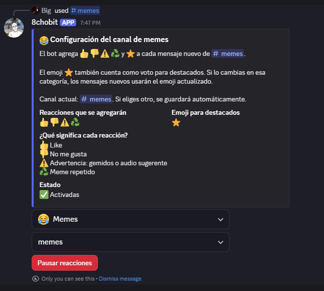
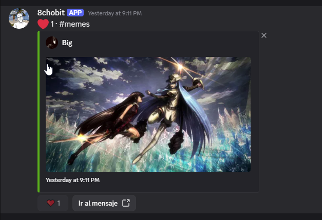
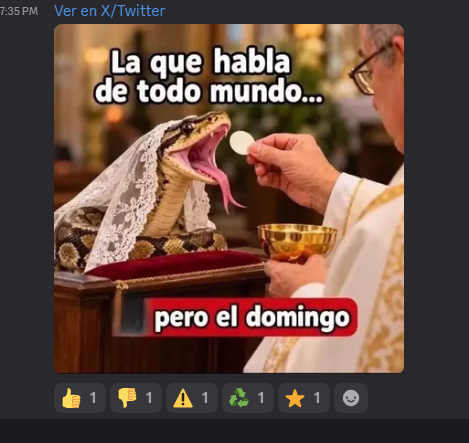

<div align="center">
  

  <p>
    
    
    
    
  </p>

  <p>
    <strong>Bot basado en discord.js v14 para administrar un canal de memes, descargar y reenviar contenido de redes sociales mediante webhooks y publicar mensajes destacados en un servidor.</strong>
  </p>
</div>

---

## Características

* **Gestión de canal de memes:** Selección automática del canal de destino con sistema de reacciones rápidas para calificar contenido (me gusta, no me gusta, advertencia de audio sugerente y meme repetido).
* **Reenvío de enlaces sociales:** Descarga medios públicos compatibles y los publica mediante webhooks usando el nombre y avatar del autor original, eliminando el mensaje inicial y suprimiendo parámetros de seguimiento (`utm_*` y específicos de plataforma).
* **Sistema de destacados:** Contabiliza reacciones de usuarios humanos y publica automáticamente los memes más votados en un canal dedicado, actualizando el conteo en tiempo real.
* **Panel de control interactivo:** Configuración centralizada directamente desde Discord mediante `/memes` o `!memes`.
* **Comandos híbridos:** Soporte simultáneo para comandos de aplicación (`slashCommands`) y comandos por prefijo configurables.

## Requisitos

* **Node.js:** Versión `22` o superior.
* **Aplicación de Discord:** Un bot registrado en el [Portal de Desarrolladores de Discord](https://discord.com/developers/applications) con permisos para invitarlo al servidor y gestionar sus intents.

## Instalación e inicio rápido

1. Clona o descarga este repositorio en tu equipo local.
2. Instala las dependencias del proyecto:
   ```sh
   npm install
   ```
3. Crea un archivo `.env` en la raíz del proyecto y define el token de autenticación:
   ```env
   DISCORD_TOKEN=tu_token
   ```
4. Revisa el archivo `settings.json` para ajustar el prefijo predeterminado (`!`), el estado de los comandos por mensaje y la presencia del bot.
5. Inicia la aplicación:
   ```sh
   npm start
   ```

> [!TIP]
> Aunque el token también puede definirse dentro de `settings.json`, se recomienda utilizar exclusivamente el archivo `.env` para evitar filtraciones accidentales en el control de versiones.

## Configuración en Discord

Para que el cliente opere correctamente, activa los siguientes **Privileged Gateway Intents** en el Portal de Desarrolladores:

| Intent | Estado | Propósito |
| :--- | :--- | :--- |
| `Message Content Intent` | **Requerido** | Necesario para procesar comandos con prefijo y analizar enlaces en el canal de memes. |
| `Server Members Intent` | Opcional | No es necesario para la configuración predeterminada. |

### Permisos recomendados

El bot solicita los intents de servidores, mensajes, reacciones y contenido de mensajes. Asegúrate de otorgarle los siguientes permisos (a nivel global o por canal específico):

* Ver canales y leer el historial de mensajes.
* Enviar mensajes y adjuntar archivos.
* Agregar reacciones y administrar mensajes (necesario para eliminar el mensaje original tras reenviar un enlace social).
* Administrar webhooks (indispensable para replicar el nombre y avatar del autor).

## Comandos y panel de control

| Comando | Alias | Permisos requeridos | Descripción |
| :--- | :--- | :--- | :--- |
| `/memes` | `!memes` | Propietario, Administrador o Administrar servidor | Abre el panel interactivo de configuración del sistema. |
| `/prefix` | `!prefix` | Propietario, Administrador o Administrar servidor | Muestra o modifica el prefijo de comandos del servidor. |
| `/ping` | `!ping` | Ninguno | Muestra la latencia actual del bot. |

> [!NOTE]
> Los comandos por prefijo pueden habilitarse o deshabilitarse desde `settings.json` mediante la propiedad `messageContentCommands.status`.

### Categorías del panel (`/memes`)

* **Resumen:** Muestra el estado general del sistema y permite activar o pausar funciones rápidamente.
* **Memes:** Define y guarda el canal principal de memes junto con sus reacciones automáticas.
* **Enlaces sociales:** Activa o pausa la descarga y republicación automática de medios externos.
* **Destacados:** Configura el canal de publicaciones destacadas, el emoji de votación, el umbral mínimo de votos y permite enviar una publicación de prueba.

### Funcionamiento del reenvío social

Cuando un usuario comparte un enlace compatible en el canal de memes, el bot limpia los parámetros de rastreo, descarga el archivo multimedia y lo publica a través de un webhook suprimendo la vista previa nativa. Si la publicación es privada, tiene restricciones regionales, supera el límite de subida según el nivel de boost del servidor o faltan permisos para borrar el mensaje original, el bot conservará el mensaje intacto y notificará si carece de permisos.

## Seguridad y privacidad

> [!WARNING]
> La configuración por servidor y las credenciales de los webhooks se almacenan localmente en `data/meme-system.sqlite`. Nunca subas este archivo ni el archivo `.env` a repositorios públicos. Si el token o las credenciales quedan expuestos, regénéralos de inmediato desde el Portal de Desarrolladores de Discord.

## Estructura del proyecto

```text
.
├── commands/         # Comandos tradicionales basados en prefijo
├── slashCommands/    # Comandos de aplicación (/)
├── events/           # Manejadores de eventos de Discord agrupados por tipo
├── handlers/         # Cargadores dinámicos de comandos y eventos
├── systems/          # Lógica principal de memes, enlaces sociales y destacados
├── database/         # Conexión y consultas de la base de datos SQLite
├── utils/            # Funciones auxiliares y limpieza de enlaces
├── data/             # Almacenamiento local de SQLite (excluir de Git)
├── screenshot/       # Capturas de pantalla del sistema
├── settings.json     # Configuración general del bot
└── package.json      # Dependencias y scripts
```

## Scripts disponibles

| Script | Acción |
| :--- | :--- |
| `npm start` | Inicia el proceso principal del bot. |
| `npm test` | Verifica e imprime la versión instalada de Node.js (sin pruebas automatizadas). |

## Capturas

<p align="center">
  
  
</p>
<p align="center">
  
  
</p>
